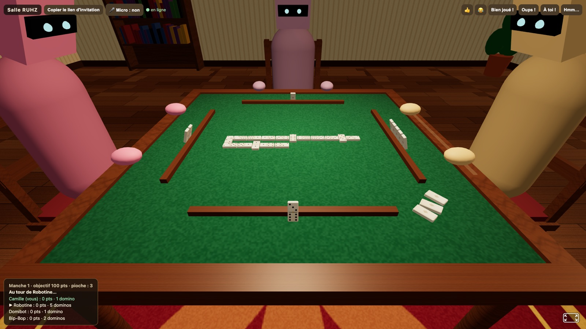
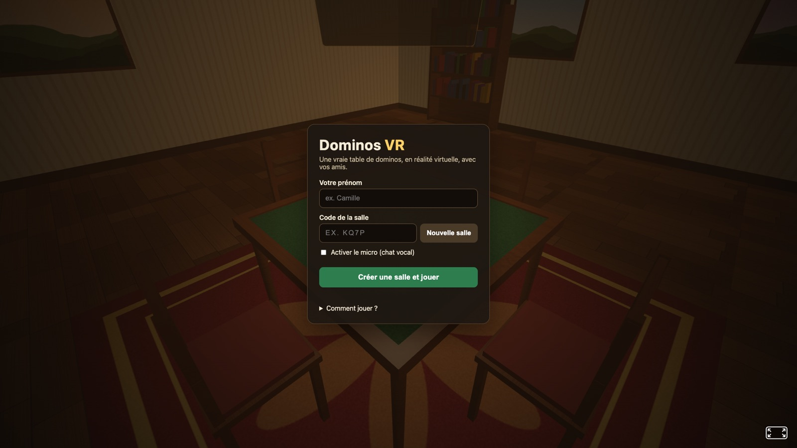

# Dominos VR

Une vraie partie de dominos en réalité virtuelle, à jouer **entre amis**, directement dans le navigateur
(casque Meta Quest, Pico, PC VR… mais aussi ordinateur et mobile).

**[▶ Jouer maintenant sur dominos.tafrap.fr](https://dominos.tafrap.fr)**, puis envoyez le lien de la salle à vos amis.



| Accueil | Fin de manche |
|---|---|
|  |  |

- Salon chaleureux, table en bois avec tapis feutré, suspension, ombres, dominos à l'échelle réelle
  (faces gravées, rivet en laiton) posés sur un chevalet devant chaque joueur.
- **Multijoueur en temps réel** (2 à 4 joueurs) : chacun voit les autres assis autour de la table,
  avec leur tête et leurs mains qui bougent, et les dos des dominos adverses.
- **Chat vocal spatialisé** (WebRTC) : la voix de vos amis vient de leur place autour de la table.
- **Bots** pour compléter la table ou s'entraîner seul ; un bot prend aussi le relais d'un joueur
  déconnecté (et le joueur retrouve sa place s'il revient).
- Règles complètes, arbitrées par le serveur (impossible de tricher : chacun ne reçoit que sa main).

## Lancer une partie

```bash
npm install
npm start
```

Ouvrez [http://localhost:3000](http://localhost:3000), entrez votre prénom et cliquez sur
**« Créer une salle et jouer »**. Envoyez le lien d'invitation (bouton en haut de l'écran) à vos amis :
ils arrivent directement dans la même salle. L'hôte (le premier arrivé) choisit le mode, l'objectif,
ajoute éventuellement des bots, puis appuie sur **Démarrer**.

### Jouer avec un casque VR

Le WebXR n'est autorisé qu'en **HTTPS** (sauf sur `localhost`). Trois possibilités :

1. **Héberger le jeu** sur un service qui fournit le HTTPS et les WebSockets (Render, Railway, Fly.io,
   un VPS…). C'est la solution idéale pour jouer avec des amis à distance. Un `render.yaml` permet de
   déployer en un clic sur Render (« New → Blueprint » avec ce dépôt) ; un `Dockerfile` est aussi fourni,
   et la variable `PORT` est respectée. Pour un VPS sous Coolify, voir [DEPLOY.md](DEPLOY.md).
2. **Tunnel temporaire** depuis votre machine, par exemple `npx localtunnel --port 3000` ou
   `cloudflared tunnel --url http://localhost:3000`, puis ouvrez l'URL HTTPS obtenue dans le casque.
3. **Réseau local avec certificat auto-signé** :
   ```bash
   npm run cert         # crée key.pem et cert.pem (nécessite openssl)
   npm run start:https  # le terminal affiche l'adresse https://192.168.x.x:3000
   ```
   Dans le navigateur du casque, acceptez l'avertissement de sécurité.

Ouvrez ensuite le lien dans le navigateur du casque, rejoignez la salle et appuyez sur le bouton **VR**.

## Commandes

| Plateforme | Jouer un domino | Autres actions |
|---|---|---|
| **Manettes VR** | Viser au laser + gâchette, ou **attraper avec la poignée** et relâcher sur un emplacement vert | Boutons du pupitre à votre droite ; joystick haut/bas : hauteur |
| **Mains (hand tracking)** | **Pincer** (pouce + index) un domino, le relâcher au-dessus d'un emplacement vert | Pincer un bouton du pupitre |
| **Ordinateur** | Cliquer sur un domino en surbrillance (puis sur l'emplacement si deux sont possibles) | Glisser pour regarder ; boutons à droite de l'écran |
| **Mobile** | Toucher un domino | Glisser pour regarder |

En VR, vous pouvez aussi **réorganiser votre main** : attrapez un domino et relâchez-le à une autre
place sur votre chevalet (ou utilisez le bouton « Trier ma main »). Les boutons **Réactions**
(👍, 😂, « Bien joué ! »…) font apparaître une bulle au-dessus de votre avatar chez les autres joueurs.

Les dominos jouables sont légèrement lumineux ; quand un domino peut aller des deux côtés, des
emplacements « fantômes » verts apparaissent au bout de la chaîne.

## Règles

Jeu double-six (28 dominos), 2 à 4 joueurs, deux variantes au choix de l'hôte :

- **Avec pioche** : 7 dominos chacun à 2 joueurs, 5 à 3 ou 4 joueurs. Si vous ne pouvez pas jouer,
  vous piochez jusqu'à pouvoir poser ; si la pioche est vide, vous passez.
- **Bloqué** : 7 dominos chacun, pas de pioche ; si vous ne pouvez pas jouer, vous passez.

Le plus gros double ouvre la première manche (à défaut, le domino le plus lourd) ; ensuite, le gagnant
de la manche précédente ouvre avec le domino de son choix. On pose un domino dont une moitié correspond
à l'un des bouts de la chaîne.

La manche se termine quand un joueur pose son dernier domino (**domino !**) ou quand plus personne ne
peut jouer (**partie bloquée** : la main la plus légère gagne, personne en cas d'égalité).
Le gagnant marque la somme des points restant dans les mains adverses.

L'hôte choisit le **format** de la partie :

- **Points** : le premier à atteindre l'objectif (50, 100, 150 ou 200 points) remporte la partie.
- **Compétition** : la partie dure exactement **12 manches** (12 poses). La première pose revient au
  joueur qui a le plus gros double (qu'il doit poser), puis la pose tourne : chaque joueur ouvre une
  manche à son tour avec le domino de son choix, soit 3 poses chacun à 4 joueurs.
  Les points se comptent de la même façon ; après la 12ᵉ manche, le plus haut total l'emporte
  (égalité possible).

## Développement

```bash
npm run dev   # redémarre le serveur à chaque modification
npm test      # règles, disposition de la chaîne, serveur multijoueur
```

| Dossier | Contenu |
|---|---|
| `server/game.js` | Règles du jeu (indépendantes du réseau) |
| `server/room.js` | Salles : joueurs, hôte, bots, tours automatiques, diffusion des états |
| `server/bot.js` | Joueur automatique |
| `server/index.js` | Serveur HTTP(S) + WebSocket (`/ws`) |
| `public/js/layout.js` | Disposition en serpent de la chaîne sur la table (partagé avec les tests) |
| `public/js/game.js` | Composant A-Frame principal : rendu de la partie, animations, interactions VR |
| `public/js/world.js`, `textures.js` | Décor et textures générées (aucune image à télécharger) |
| `public/js/avatars.js`, `voice.js`, `net.js` | Avatars, chat vocal WebRTC, connexion au serveur |

Le chat vocal passe en pair-à-pair via des serveurs STUN publics. Derrière certains réseaux
(4G, entreprise…), il faut un relais TURN. Avec un coturn configuré en `use-auth-secret`, le serveur
signe des identifiants valables 24 h et le secret ne quitte jamais le serveur :

```bash
TURN_URLS='turn:turn.exemple.fr:3478' TURN_SECRET='même secret que coturn' npm start
```

La mise en production sur Coolify (jeu + coturn) est décrite dans [DEPLOY.md](DEPLOY.md).

## Licence

Logiciel libre distribué sous [licence MIT](LICENSE).
